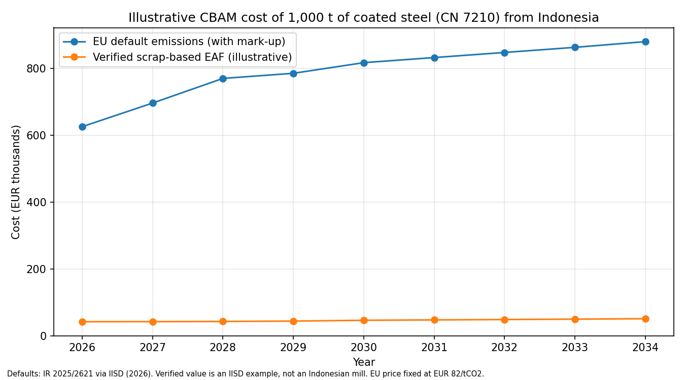

# CBAM-Indonesia-Calculator
## Preview

Run the app locally with `streamlit run app.py`.

## Method and sources

Cost per tonne = (embedded emissions - benchmark x free allocation share left) x certificate price.

- Free allocation share: 97.5% in 2026 falling to 0% in 2034 (Directive 2003/87/EC Art. 10a(1a)).
- Default emissions: Indonesia CN 7210 base value of 8.25 tCO2/t plus a 10% mark-up in 2026, 20% in 2027, 30% from 2028 (IR (EU) 2025/2621).
- Benchmarks: IR (EU) 2025/2620 Annex, as used in IISD (2026).
- Only direct emissions are priced for steel.
- Validation: the calculator reproduces IISD's figure of about EUR 574/t for an Indonesian default in 2026 (see tests).

Limitations: one product (CN 7210), cross-sectoral correction factor assumed 1.0, the verified-emissions figure is illustrative, and the carbon-price deduction for Indonesia's ETS is not modelled yet.

Source: IISD (2026), Navigating the EU Carbon Border Adjustment Mechanism: An exporter's technical guide.
