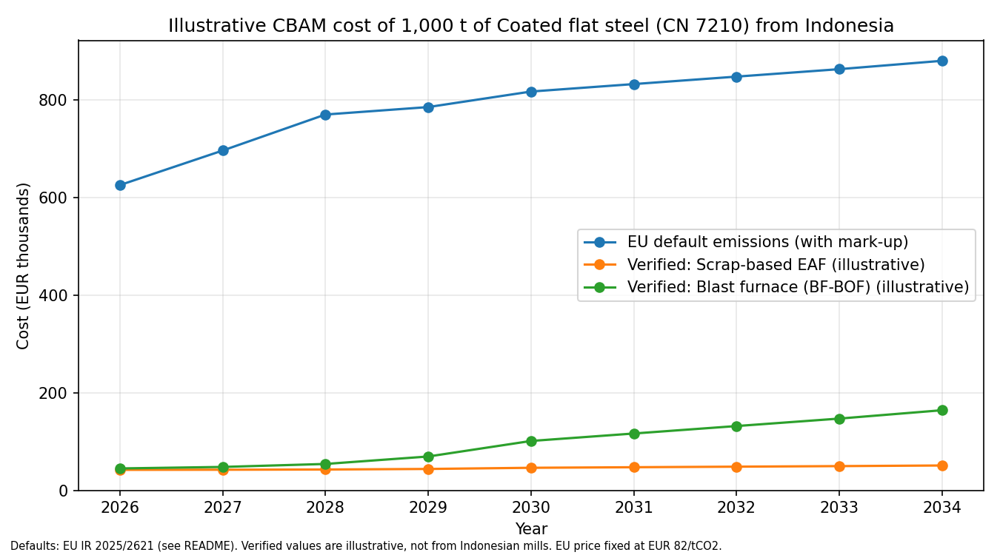
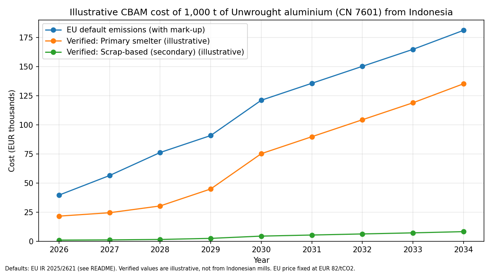

# CBAM Indonesia Calculator

**Live app:** https://cbam-calculator-id.streamlit.app

An open-source model of how the EU Carbon Border Adjustment Mechanism (CBAM) affects Indonesian steel and aluminium exports, and what exporters, or the Indonesian government, can do about it. Written in Python, tested, with every input traced to a source.

> **Status: v1.** A research and learning tool using illustrative inputs. Not legal or financial advice.

## Why this matters

Since 1 January 2026, EU importers must pay for the emissions embedded in imported steel, aluminium and other goods. Exporters who cannot prove their emissions are assigned EU default values, plus a mark-up of 10% in 2026 rising to 30% from 2028. For coated steel, Indonesia's default is the highest among the countries IISD compares. Indonesia's carbon pricing does not yet cover steel or aluminium, so none of this carbon cost is currently deductible at home.

## Key findings

Results for a 1,000 tonne shipment with the EU carbon price fixed at EUR 82/tCO2. All "verified" emissions values are illustrative, not from Indonesian mills.

**1. For steel, proving emissions is worth a lot, and from day one.** On EU default values, the bill is about EUR 625k in 2026 and rises to about EUR 879k in 2034. A verified scrap-based electric arc furnace route costs only about EUR 42k to EUR 51k, a saving of roughly EUR 583k to EUR 829k. The commonly quoted "only 2.5% is charged in 2026" is true only for producers at the EU benchmark. Emissions above the benchmark are charged in full from the start.

**2. For primary aluminium it is worth far less. Scrap-based aluminium gains most.** Only direct emissions are priced, so the EU default (about 1.9 to 2.2 tCO2/t) is not far above what a typical smelter emits (about 1.65). The saving from verification is roughly EUR 18k to EUR 46k per 1,000 t, against EUR 583k to EUR 829k for steel. A scrap-based producer pays under EUR 10k in every year.

**3. A domestic carbon price moves the money from Brussels to Jakarta without raising the exporter's total cost.** The EU lets importers deduct a carbon price effectively paid in the country of origin. Example: for scrap-based steel in 2026 the EU bill is about EUR 41.90 per tonne. If Indonesia charged EUR 10 per tonne of CO2, the exporter would pay EUR 6.20 at home and EUR 35.70 to the EU: the same EUR 41.90 in total, but EUR 6.20 stays in Indonesia. The total only rises if the domestic price is so high that the EU bill would fall below zero. The app has a slider to explore this. Today the realistic setting is zero, because Indonesia's ETS covers coal power plants only.

## How it works

Cost per tonne = (embedded emissions - benchmark x free allocation share left) x certificate price, optionally minus the carbon price paid at home x embedded emissions, never below zero.

- **Free allocation share:** 97.5% in 2026, falling to 0% in 2034 (Directive 2003/87/EC, Art. 10a(1a)).
- **Default emissions:** country and product specific, plus a mark-up of 10% (2026), 20% (2027), 30% (2028 onward) (Implementing Regulation (EU) 2025/2621).
- **Benchmarks:** from the EU free allocation regulation (Implementing Regulation (EU) 2025/2620).
- **Scope:** direct emissions only, as for steel and aluminium under CBAM.
- **Validation:** the calculator reproduces IISD's published figure of about EUR 574/t for an Indonesian steel default in 2026 (at EUR 75.28/tCO2), and two other worked examples from the same guide. These are automated tests.

## Inputs and how far to trust them

| Input | Value | Status |
|---|---|---|
| Free allocation schedule | 97.5% to 0%, 2026 to 2034 | Consistent across IISD and several other sources |
| Default mark-ups | 10% / 20% / 30% | Consistent across multiple sources |
| Steel (CN 7210) Indonesia default | 8.25 tCO2/t before mark-up | Published guide (IISD 2026, Table 5) |
| Steel default benchmark | 1.491 tCO2/t | Published guide (IISD 2026 worked example) |
| Scrap-EAF steel benchmark | 0.1118 tCO2/t | **Derived from IISD Table 2. To verify against the EU annex** |
| Aluminium (CN 7601) Indonesia default | 1.70 tCO2/t before mark-up | **Single secondary source. To verify against the EU annex** |
| Aluminium benchmarks | 1.423 (primary), 0.091 (secondary) | Trade press reports (Argus, Reuters), matches the EU ETS benchmark |
| "Verified" emissions examples | 0.62 (scrap EAF), 2.0 (BF-BOF), 1.65 (primary smelter), 0.10 (scrap-based aluminium) | **Illustrative, not from Indonesian installations** |

Every input lives in `data/` with a source on each row.

## Limitations

- Two products only (coated steel CN 7210, unwrought aluminium CN 7601).
- Coated steel is a "complex good": verified figures also need verified data from the mills that supplied the steel it is made from, otherwise defaults apply for those inputs (IISD 2026). The verified lines are a best case.
- The EU price is held fixed. Forecasts for 2034 are EUR 150 to 200/tCO2 (IISD 2026), which would scale every line up.
- The cross-sectoral correction factor is assumed to be 1.0.
- The carbon price deduction follows a simplified reading of IISD's equation. The EU rules are still in draft (May 2026), and exporters on default emissions can only claim a deduction through an EU default carbon price that does not yet exist for Indonesia.
- I could not find reliable product-level trade data for fertilisers or cement, so they are not modelled.

## Run it locally

    git clone https://github.com/taqihariza/CBAM-Indonesia-Calculator.git
    cd CBAM-Indonesia-Calculator
    python3 -m venv .venv
    source .venv/bin/activate
    pip install -r requirements.txt
    streamlit run app.py
    python -m pytest

## Repository

- `app.py`: Streamlit app with product, route, EU price and domestic carbon price controls.
- `calculator.py`: the model, in small tested functions.
- `data/`: `schedule.csv` (phase-out and mark-ups), `products.csv` (defaults and benchmarks), `routes.csv` (verified routes). Sources on every row.
- `make_chart.py`: regenerates the charts in `charts/`.
- `test_calculator.py`, `test_deduction.py`: 18 automated tests.

## Sources

- IISD (2026), *Navigating the European Union's Carbon Border Adjustment Mechanism: An exporter's technical guide*: https://www.iisd.org/system/files/2026-06/navigating-eu-carbon-border-adjustment-mechanism.pdf
- Regulation (EU) 2023/956 (CBAM) and Implementing Regulations (EU) 2025/2620, 2025/2621 and 2025/2547.
- Argus and Reuters reporting on the EU aluminium benchmarks.
- ICAP and the World Bank Carbon Pricing Dashboard for Indonesia's ETS.

## Related work

- [Indonesia-ETS-Model](https://github.com/taqihariza/Indonesia-ETS-Model): a Python model of Indonesia's power-sector emissions trading scheme.

## Author

Built by Taqi Hammam Ariza as part of an interest in carbon pricing design and inclusive climate policy for emerging economies. MIT licence.
